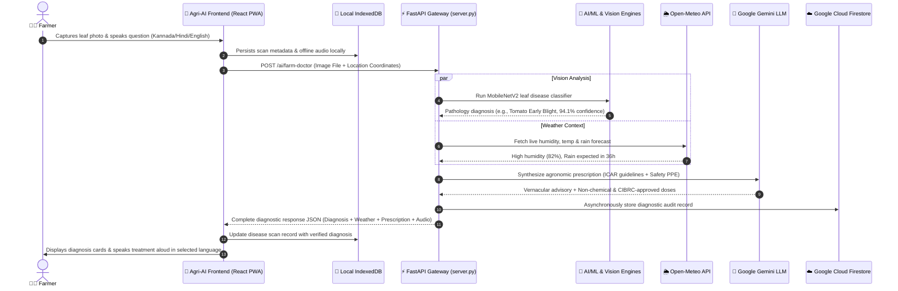

# Agri-AI (ಕೃಷಿಮಿತ್ರ – KrishiMitra) 🌱🌾
### *AI-Powered Multimodal Farm Intelligence & Decision Support Ecosystem*

[](https://react.dev/)
[](https://tailwindcss.com/)
[](https://fastapi.tiangolo.com/)
[](https://www.python.org/)
[](https://www.tensorflow.org/)
[](https://scikit-learn.org/)
[](https://aistudio.google.com/)
[](https://developer.mozilla.org/en-US/docs/Web/API/IndexedDB_API)
[](https://firebase.google.com/docs/firestore)

---

## 📌 Table of Contents
- [1. Project Introduction](#1-project-introduction)
- [2. Problem Statement & Proposed Solution](#2-problem-statement--proposed-solution)
- [3. Key Features](#3-key-features)
- [4. Technology Stack](#4-technology-stack)
- [5. System Architecture](#5-system-architecture)
- [6. Architecture Diagram (Mermaid)](#6-architecture-diagram-mermaid)
- [7. Detailed Source Code Breakdown](#7-detailed-source-code-breakdown)
  - [Frontend Architecture (`src/`)](#frontend-architecture-src)
  - [Backend & API Gateway (`app/` & `backend/`)](#backend--api-gateway-app--backend)
  - [Database & Storage Engines](#database--storage-engines)
  - [AI & Machine Learning Microservices (`modules/`)](#ai--machine-learning-microservices-modules)
  - [Core REST API Reference](#core-rest-api-reference)
- [8. System Workflow & Data Flow](#8-system-workflow--data-flow)
- [9. Installation & Setup Guide](#9-installation--setup-guide)
- [10. Running the Application](#10-running-the-application)
- [11. Application Screenshots](#11-application-screenshots)
- [12. Future Enhancements](#12-future-enhancements)
- [13. Contributors & Acknowledgments](#13-contributors--acknowledgments)

---

## 1. Project Introduction

**Agri-AI** (also known as **KrishiMitra / ಕೃಷಿಮಿತ್ರ**) is a production-grade, multimodal agricultural intelligence system and Progressive Web Application (PWA). It is engineered to bridge the gap between advanced artificial intelligence and grassroots farming communities.

Agri-AI equips smallholder farmers, agronomists, and extension officers with clinical real-time diagnostics and predictive farm planning tools. The platform combines:
- **Computer Vision** for instantaneous plant leaf disease and insect pest identification.
- **Tabular Machine Learning** for data-driven crop yield forecasting ($R^2 = 0.9695$).
- **Generative AI** powered by Google Gemini for conversational agricultural advisory with strict ICAR/CIBRC chemical safety protocols.
- **Speech Processing & Voice Interaction** enabling seamless voice-in/speech-out accessibility for farmers in their native languages (**Kannada, Hindi, English, Telugu, and Tamil**).
- **Hyper-Local Agro-Meteorology** delivering real-time weather analytics, 48-hour rainfall warnings, and dynamic water-balance irrigation schedules.
- **Offline-First Resilience** with browser-native IndexedDB caching, guaranteeing access to vital farm records and advisory even in remote regions with intermittent or absent internet connectivity.

---

## 2. Problem Statement & Proposed Solution

### The Agricultural Dilemma
1. **Pest & Disease Losses**: Indian agriculture incurs annual harvest losses between **20% and 40%** due to unaddressed pests and fungal/bacterial leaf blights. Farmers often identify pathogens too late or apply incorrect, hazardous chemicals.
2. **Suboptimal Crop & Yield Decisions**: Smallholders frequently select crops without assessing localized soil chemistry (pH, NPK levels), seasonal agro-climatic conditions, or water availability, causing poor yields and financial distress.
3. **Resource Inefficiency**: Unscheduled flood irrigation and uncalibrated chemical fertilizers deplete groundwater reserves, degrade soil health, and escalate farming costs.
4. **Digital & Language Barriers**: Most agricultural software is English-centric and text-heavy, alienating rural farmers who rely on vernacular communication and oral guidance.
5. **Connectivity Constraints**: Farms are situated in rural belts where mobile networks are unstable; cloud-dependent tools frequently fail during critical field scouting.

### The Agri-AI Solution
Agri-AI delivers a holistic, farmer-first technological ecosystem:
- **Vision-Driven Field Diagnostics**: Farmers capture plant foliage or insect photos using their mobile camera; MobileNetV2 deep learning models identify the exact pathology within milliseconds and recommend organic, biological, and ICAR-approved IPM remedies.
- **Predictive Harvest Analytics**: A trained Random Forest regression pipeline forecasts expected harvest output (metric tons/hectare and quintals/acre) given soil chemistry, rainfall, ambient temperature, and plot size.
- **Vernacular Conversational Ag-Doctor**: Farmers can speak directly to Agri-AI in **Kannada (ಕನ್ನಡ), Hindi (हिन्दी), Telugu (తెలుగు), Tamil (தமிழ்), or English**. The system transcribes audio, consults an agronomically constrained Gemini model, and speaks the guidance back aloud.
- **Precision Agro-Hydrology**: Live Open-Meteo telemetry checks 48-hour precipitation windows before recommending irrigation, conserving electricity and water.
- **Hybrid Offline/Cloud Architecture**: Field records, disease scan histories, and farmer profiles persist locally via IndexedDB with automatic schema migrations and bidirectional JSON/CSV export, coupled with Google Cloud Firestore backend synchronization.

---

## 3. Key Features

| Feature Pillar | Capabilities |
| :--- | :--- |
| 🍃 **Plant Disease Scanner** | Live camera and image upload diagnostic engine classifying tomato, potato, pepper, wheat, rice, and maize pathologies with severity indicators and non-chemical/chemical remedies. |
| 🐛 **Pest Identification & IPM** | Detects destructive pests (Fall Armyworm, Aphids, Mites, Stem Borers) and outlines life-cycle damage symptoms, Economic Threshold Levels (ETL), and bio-control protocols. |
| 📊 **Crop Harvest Yield Forecasting** | Scikit-Learn Random Forest model ($R^2 = 0.9695$, MAE = 1.5156) forecasting harvest output per hectare and per acre based on 10 agro-climatic variables with confidence intervals. |
| 👨‍⚕️ **Clinical Farm Doctor Engine** | Triages vision analysis with real-time temperature, humidity, and wind conditions; enforces uncertainty gating (<60% confidence triggers KVK/RSK agricultural center referrals). |
| 🎙️ **Multilingual Voice Assistant** | Web Speech API and backend Speech-to-Text $\rightarrow$ Gemini Chatbot $\rightarrow$ Text-to-Speech loop supporting authentic Kannada, Hindi, and regional agronomy terminology. |
| 🌦️ **Agro-Meteorology & Alerts** | Real-time weather monitoring, 7-day forecasts, and agricultural hazard detection (frost, heatwave, heavy rain, windstorm). |
| 💧 **Smart Irrigation & Water Tracking** | Soil-moisture water balance engine tracking farm water assets (borewells, open wells, farm ponds) and issuing 48-hour rain warning bypasses. |
| 📅 **Dynamic Farming Calendar** | 6-stage crop growth timeline generator (Germination $\rightarrow$ Vegetative $\rightarrow$ Tillering $\rightarrow$ Heading $\rightarrow$ Grain Filling $\rightarrow$ Maturity) with automated reminders. |
| 📁 **Farmer Profile & Records System** | IndexedDB-backed management of farm GPS coordinates, soil test histories, crop schedules, and photo scan logs with JSON/CSV export/import. |
| 📈 **Market Price Intelligence (APMC)** | Real-time crop price tracking across agricultural mandis with trend analytics and price forecasting. |

---

## 4. Technology Stack

### Frontend Client (Progressive Web Application)
- **Framework & Build Tool**: React 18 (`react`, `react-dom`), Vite 6 (`@vitejs/plugin-react`)
- **Styling & Layout**: Tailwind CSS 3.4, PostCSS, Autoprefixer
- **UI Components & Icons**: Lucide React (`lucide-react`)
- **State & Context Management**: React Context API (`LanguageContext`, `OfflineContext`)
- **Client Storage**: Browser IndexedDB (`indexedDBStorage.js`), LocalStorage
- **Hardware Integration**: HTML5 MediaDevices API (Camera Scanner), Web Speech Recognition & SpeechSynthesis APIs

### Backend & Microservices Layer
- **Language & Runtime**: Python 3.9 / 3.11
- **API Framework**: FastAPI 0.110+, Starlette, Uvicorn (ASGI web server)
- **Data Validation & Serialization**: Pydantic v2 schemas (`BaseModel`, `Field`)
- **Environment & Configuration**: `python-dotenv`, `pydantic-settings`
- **Multipart Form Processing**: `python-multipart`

### Artificial Intelligence & Machine Learning
- **Deep Learning / Computer Vision**: TensorFlow 2.15+ / Keras (MobileNetV2 Transfer Learning), OpenCV (`opencv-python-headless`), Pillow (`PIL`)
- **Tabular Machine Learning**: Scikit-Learn 1.4+ (Random Forest Regressor, Linear Regression), NumPy, Pandas, Joblib
- **Generative AI & LLMs**: Google Gemini API (`@google/genai`, `google-generativeai`, `gemini-1.5-flash`)
- **Voice & Audio Processing**: Python `SpeechRecognition`, `pydub`, standard wave/base64 audio serializers

### External APIs & Cloud Services
- **Weather Telemetry**: Open-Meteo REST API (free agricultural meteorological telemetry)
- **Cloud Database**: Google Cloud Firestore via Firebase Admin SDK (7 structured collections)
- **Mapping & Geolocation**: Google Maps JavaScript API (with autonomous fallback farm plot simulator)

---

## 5. System Architecture

Agri-AI follows a decoupled, resilient **4-Tier Architectural Pattern** ensuring zero downtime and rapid inference:

```
[ Tier 1: Client Presentation Layer ]
  - React 18 + Vite 6 PWA (Mobile / Desktop Responsive)
  - Multilingual UI (Kannada, English, Hindi)
  - Hardware Abstraction: Camera API, Web Speech Audio Engine
  - Local IndexedDB Engine (Zero-Latency Offline Data Store)
               │
               ▼  HTTP REST / JSON / Multipart Form-Data
[ Tier 2: API Gateway & Orchestration Layer ]
  - FastAPI Unified Server (Port 8000 / server.py)
  - CORS Middleware & Security Headers
  - Pydantic v2 Request Validation & Error Handlers
  - Auto-Generated Swagger / OpenAPI Documentation (/docs)
               │
               ├────────────────────────┬────────────────────────┐
               ▼                        ▼                        ▼
[ Tier 3: AI/ML Inference ]  [ Agronomy Rules Engine ]  [ Telemetry Services ]
  - MobileNetV2 CNNs (Vision)  - ICAR/FAO Soil Health    - Open-Meteo Weather
  - Random Forest Regressor    - Water Balance Matrix    - 48h Rain Predictor
  - Google Gemini 1.5 Flash    - 6-Stage Crop Calendar   - Geocoding API
  - Clinical Farm Doctor Loop  - Chemical Safety Guard
               │                        │                        │
               └────────────────────────┼────────────────────────┘
                                        ▼
[ Tier 4: Data & Persistence Layer ]
  - Google Cloud Firestore (7 Cloud Collections: Farmers, Soil, Weather, Irrigation, Calendars, Water, Crops)
  - Transparent In-Memory Fallback Engine (Runs seamlessly if Firebase credentials are omitted)
  - Client-Side IndexedDB (Local Profiles, Activity Logs, Scans, Reminders)
```

1. **Client Presentation Tier**: React 18 Progressive Web Application running Tailwind CSS. Communicates with device hardware (camera and microphone) and maintains continuous operational capability via client-side IndexedDB caching.
2. **API Gateway & Routing Tier**: FastAPI ASGI application (`server.py` & `app/main.py`) routing requests across `/ai/*` and `/api/v1/*`. Handles input validation, file buffering, and CORS headers.
3. **Intelligence & Processing Tier**: Hosts deep learning vision classifiers, tabular regression models, the Gemini conversational engine, and ICAR agronomic rules.
4. **Data & Telemetry Tier**: Synchronizes cloud records to Firestore when online while consuming live meteorological feeds from Open-Meteo.

---

## 6. Architecture Diagram (Mermaid)

```mermaid
flowchart TD
    %% Client Layer
    subgraph ClientLayer["🖥️ Tier 1: Client Presentation Layer (PWA)"]
        UI["React 18 + Tailwind CSS SPA"]
        Cam["Camera Scanner (MediaDevices API)"]
        VoiceIn["Voice Audio Engine (Web Speech API)"]
        IDB[("Client IndexedDB & LocalStorage")]
        
        UI <--> Cam
        UI <--> VoiceIn
        UI <--> IDB
    end

    %% Gateway Layer
    subgraph GatewayLayer["⚡ Tier 2: API Gateway (FastAPI / Uvicorn)"]
        API["FastAPI Orchestrator (server.py:8000)"]
        CORS["CORS Middleware & Pydantic Validation"]
        Docs["Swagger UI (/docs) & ReDoc (/redoc)"]
        
        API --- CORS
        API --- Docs
    end

    %% Intelligence Layer
    subgraph AIEngine["🧠 Tier 3: AI / ML & Analytical Services"]
        DiseaseMod["MobileNetV2 CNN (Leaf Disease Detection)"]
        PestMod["Pest Identifier & IPM Protocol Engine"]
        YieldMod["Random Forest Regressor (Yield Prediction)"]
        GeminiLLM["Google Gemini 1.5 Flash (Agri-Chatbot)"]
        DoctorMod["Clinical Farm Doctor (Multimodal Fusion)"]
        VoiceMod["Voice Pipeline (STT -> Gemini -> Audio TTS)"]
        AgronomyRules["ICAR / FAO Soil & Water Balance Engine"]
    end

    %% Data & Telemetry
    subgraph DataLayer["🌐 Tier 4: External Services & Data Persistence"]
        OpenMeteo["Open-Meteo Weather API"]
        FirestoreDB[("Google Cloud Firestore")]
        MockFallback[("In-Memory DB Fallback Engine")]
    end

    %% Data Flow Connections
    UI -- "REST / FormData (Port 8000)" --> API
    
    API --> DiseaseMod
    API --> PestMod
    API --> YieldMod
    API --> GeminiLLM
    API --> DoctorMod
    API --> VoiceMod
    API --> AgronomyRules
    
    DoctorMod -.-> DiseaseMod
    DoctorMod -.-> OpenMeteo
    DoctorMod -.-> GeminiLLM
    
    VoiceMod -.-> GeminiLLM
    
    AgronomyRules <--> OpenMeteo
    API <--> FirestoreDB
    FirestoreDB -. "Credential Fallback" .-> MockFallback

    %% Styling
    classDef client fill:#E8F5E9,stroke:#2E7D32,stroke-width:2px;
    classDef gateway fill:#E1F5FE,stroke:#0277BD,stroke-width:2px;
    classDef ai fill:#FFF3E0,stroke:#EF6C00,stroke-width:2px;
    classDef data fill:#F3E5F5,stroke:#7B1FA2,stroke-width:2px;

    class ClientLayer,UI,Cam,VoiceIn,IDB client;
    class GatewayLayer,API,CORS,Docs gateway;
    class AIEngine,DiseaseMod,PestMod,YieldMod,GeminiLLM,DoctorMod,VoiceMod,AgronomyRules ai;
    class DataLayer,OpenMeteo,FirestoreDB,MockFallback data;
```



---

## 7. Detailed Source Code Breakdown

### Frontend Architecture (`src/`)

The client application is organized into modular directories adhering to clean code standards:

```text
src/
├── App.jsx                     # Root application coordinator, navigation state, and modal routing
├── main.jsx                    # Vite React DOM entry point
├── index.css                   # Global Tailwind utilities and agronomic design themes
├── pages/                      # 12 Core feature page modules
│   ├── AIAssistantPage.jsx     # Conversational Gemini chatbot with speech recognition & audio synthesis
│   ├── CropRecommendationPage.jsx # Multi-factor crop suitability wizard & planning cards
│   ├── DashboardPage.jsx       # Consolidated farmer command center & quick-action hubs
│   ├── DiseaseDetectionPage.jsx# Live camera scanner & photo diagnostic leaf analysis
│   ├── FarmerProfilePage.jsx   # Profile management, land holding details & village metadata
│   ├── FarmingCalendarPage.jsx # 6-stage lifecycle schedule generator with reminder alerts
│   ├── LocationSelectionPage.jsx # Interactive farm plot coordinate picker & simulator
│   ├── MarketPricesPage.jsx    # Real-time mandi commodity price intelligence
│   ├── MyFarmingRecordsPage.jsx# Tabular & card views for cultivated acres, yields & photos
│   └── WeatherPage.jsx         # 7-day meteorological forecast, rainfall & agro-hazard alerts
├── components/                 # Reusable atomic UI components
│   ├── auth/                   # Registration, login & password recovery dialogs
│   ├── common/                 # Header, Navigation, Footer, Alert badges & Language switchers
│   ├── dashboard/              # Weather cards, metric counters, recent record widgets
│   ├── features/               # Disease camera overlays, audio visualizers, yield dials
│   └── offline/                # Offline status pills and synchronization status banners
├── context/
│   ├── LanguageContext.jsx     # Multilingual state management (Kannada default, English, Hindi)
│   └── OfflineContext.jsx      # Network connectivity monitor and sync trigger
├── services/                   # Client-side API gateways and domain service layers
│   ├── apiClient.js            # Unified HTTP client routing requests to FastAPI (http://localhost:8000)
│   ├── cropRecommendationService.js # 100-point localized crop scoring algorithms
│   ├── farmerDataService.js    # Storage abstraction decoupling UI from database engines
│   ├── geminiChatService.js    # Client-side Gemini fallback integration
│   ├── geminiDiseaseService.js # Clinical plant pathology knowledge heuristics
│   └── marketPriceService.js   # APMC commodity market data transformers
└── utils/
    ├── indexedDBStorage.js     # Native IndexedDB wrapper with versioned stores & JSON/CSV import-export
    ├── notificationService.js  # HTML5 Web Notification reminders for field activities
    └── plantTaxonomy.js        # Agricultural botanical reference data
```

---

### Backend & API Gateway (`app/` & `backend/`)

The backend is built with FastAPI, orchestrated through a single unified launcher (`server.py`):

```text
├── server.py                   # Master launcher exposing both AI microservices and Member 3 backend
├── app/                        # AgriSmart AI Core Microservices Layer
│   ├── main.py                 # FastAPI application definition, OpenAPI tags, CORS, and routers
│   ├── config.py               # Pydantic BaseSettings loading .env configurations
│   └── routes/                 # Specialized endpoint routers
│       ├── ai_service_routes.py# Unified /ai/* endpoints (Disease, Pest, Yield, Chatbot, Doctor, Voice)
│       ├── disease_routes.py   # Specialized leaf pathology endpoints
│       ├── pest_routes.py      # Entomological identification endpoints
│       ├── yield_routes.py     # Crop harvest regression endpoints
│       ├── chatbot_routes.py   # Gemini conversational endpoints
│       ├── farm_doctor_routes.py # Clinical multi-modal diagnostic endpoints
│       └── voice_routes.py     # Audio STT and TTS endpoints
└── backend/app/                # Agro-Hydrology, Soil & Location Intelligence
    ├── api/                    # Route handlers for weather, soil, crops, irrigation, calendar, water
    ├── services/               # Open-Meteo clients, ICAR screening models, FAO water balance
    ├── models/schemas.py       # Strict Pydantic input/output schemas
    └── database/firebase.py    # Google Cloud Firestore client with zero-config in-memory fallback
```

---

### Database & Storage Engines

#### 1. Browser IndexedDB (Client-Side Storage)
Agri-AI implements a high-capacity, non-blocking IndexedDB storage engine (`src/utils/indexedDBStorage.js`) configured with dedicated object stores:
- `farmer_profile`: Farmer name, contact, village, district, state, total land acres, soil category, irrigation types.
- `farming_records`: Logs of cultivated crops, sowing dates, applied inputs, harvest yields, and attached photo files.
- `crop_schedules`: 6-stage crop calendar instances with real-time progress tracking.
- `farming_reminders`: Time-sensitive operational alerts (irrigation, fertilization, pest scouting).
- `disease_scans`: Archive of diagnostic results, confidence percentages, and recommended treatments.
- `chat_sessions`: Full conversation history with the AI agronomist.

#### 2. Google Cloud Firestore (Cloud Storage)
The backend connects to Google Cloud Firestore across **7 primary collections**:
1. `farmers` — Farmer profiles, farm coordinates, and land characteristics.
2. `soil_records` — Soil health cards (pH, Nitrogen, Phosphorus, Potassium, Moisture).
3. `weather_records` — Cached meteorological observations and hazard alerts.
4. `crop_recommendations` — Historical suitability recommendation reports.
5. `irrigation_records` — Water application logs and 48-hour rainfall check logs.
6. `crop_calendars` — Generated variety timelines and growth milestone dates.
7. `water_records` — Farm water asset inventories (borewells, open wells, farm ponds, canals).

> [!NOTE]
> **Resilient In-Memory Fallback**: If `FIREBASE_CREDENTIALS_PATH` is unconfigured, `backend/app/database/firebase.py` transparently transitions to an in-memory dictionary-backed storage engine. The application runs with zero configuration out-of-the-box.

---

### AI & Machine Learning Microservices (`modules/`)

```text
modules/
├── disease_detection/          # Crop leaf disease classification
│   ├── detector.py             # MobileNetV2 model loader and inference engine
│   ├── prediction.py           # Preprocessing, confidence scoring, and top-3 ranking
│   ├── recommendations.py      # Biological, chemical, and preventive IPM guidelines
│   └── train_disease_model.py  # Model training pipeline on PlantVillage dataset
├── pest_identification/        # Agricultural insect pest detection
│   ├── identifier.py           # Deep learning pest feature extractor
│   ├── pest_data.py            # Comprehensive entomological database with ETL thresholds
│   ├── prediction.py           # Bounding inference and damage symptom mapping
│   └── recommendations.py      # Cultural, mechanical, and bio-pesticide controls
├── yield_prediction/           # Harvest tonnage forecasting
│   ├── predictor.py            # Model loader & unit converter (MT/ha, Quintals/acre)
│   ├── prediction.py           # Tabular inference with confidence interval bounds
│   └── train_yield_model.py    # Random Forest training script ($R^2 = 0.9695$)
├── chatbot/                    # Multilingual agricultural advisor
│   ├── chatbot.py              # Google Gemini API connector with safety filters
│   ├── languages.py            # Language normalization for Kannada, Hindi, Telugu, Tamil, English
│   └── bot.py                  # Dialogue state manager
├── farm_doctor/                # Clinical agricultural diagnostic triage
│   ├── farm_doctor.py          # Multimodal diagnostic synthesis (Vision + Weather + Prescriptions)
│   └── doctor.py               # Confidence threshold gating (<60% referral mechanism)
└── voice_assistant/            # Voice interaction loop
    ├── voice_assistant.py      # Speech-to-Text -> Gemini -> Text-to-Speech coordinator
    ├── language_support.py     # BCP-47 locale handlers & vernacular phonetic dictionaries
    └── voice_processor.py      # Audio stream resampler and WAV/MP3 formatter
```

#### Machine Learning Model Evaluation
The crop yield model was evaluated on 4,000 agricultural samples across 10 environmental features:

| Model Architecture | Mean Absolute Error (MAE) | Root Mean Squared Error (RMSE) | $R^2$ Score |
| :--- | :---: | :---: | :---: |
| Baseline (Mean Regressor) | 12.6425 | 17.2047 | -0.0005 |
| Baseline (Linear Regression) | 1.5858 | 3.0280 | 0.9690 |
| **Random Forest Regressor (Agri-AI)** | **1.5156** | **3.0060** | **0.9695** |

*Result: Random Forest achieved an **88.01% error reduction** over baseline mean estimators.*

---

### Core REST API Reference

All primary AI endpoints are served under the `/ai` prefix:

| Endpoint | Method | Payload Type | Description |
| :--- | :---: | :--- | :--- |
| `POST /ai/disease-detection` | `POST` | `multipart/form-data` | Vision leaf pathology diagnosis with confidence scores and remedies |
| `POST /ai/pest-detection` | `POST` | `multipart/form-data` | Visual identification of crop pests, damage analysis, and IPM protocols |
| `POST /ai/yield-prediction` | `POST` | `application/json` | Tabular crop yield forecasting in Metric Tons/ha and Quintals/acre |
| `POST /ai/chatbot` | `POST` | `application/json` | Multilingual conversational advisor powered by Google Gemini |
| `POST /ai/farm-doctor` | `POST` | `multipart/form-data` | Clinical triage combining image analysis, live weather, and ICAR safety |
| `POST /ai/voice-assistant` | `POST` | `multipart/form-data` | End-to-end voice loop: spoken audio input $\rightarrow$ synthesized audio response |
| `GET /api/v1/weather/forecast` | `GET` | Query Parameters | 7-day agro-meteorological forecast and hazard warnings (Open-Meteo) |
| `POST /api/v1/soil/analyze` | `POST` | `application/json` | ICAR/FAO soil nutrient screening, NPK balance, and fertilizer advice |
| `POST /api/v1/irrigation/recommend` | `POST` | `application/json` | Evapotranspiration water balance with 48-hour rainfall bypass check |
| `GET /health` | `GET` | None | Unified system health check and active service discovery |

---

## 8. System Workflow & Data Flow



---

## 9. Installation & Setup Guide

### Prerequisites
- **Node.js**: v18.0.0 or higher (`node -v`)
- **npm**: v9.0.0 or higher (`npm -v`)
- **Python**: v3.9 or v3.11 (`python3 --version`)
- **Git**: Installed and configured on your system

### 1. Clone the Repository
```bash
git clone https://github.com/your-username/agri-ai.git
cd agri-ai
```

### 2. Configure Environment Variables
Copy the template configuration files into active `.env` files:

```bash
# In the root directory (Frontend & Backend configurations):
cp .env.example .env
```

Open `.env` in your editor and configure the keys:
```ini
# Frontend Settings
VITE_API_URL=http://localhost:8000
VITE_GOOGLE_MAPS_API_KEY=your_optional_google_maps_key

# Backend Server Settings
HOST=0.0.0.0
PORT=8000
ENVIRONMENT=development

# Google Gemini API Key (Get from https://aistudio.google.com/)
GEMINI_API_KEY=your_gemini_api_key_here
GEMINI_MODEL=gemini-1.5-flash

# Firebase Firestore (Optional - runs in-memory if omitted)
FIREBASE_CREDENTIALS_PATH=
```

---

## 10. Running the Application

### Option A: Run the Frontend (Vite + React)
```bash
# 1. Install frontend dependencies
npm install

# 2. Start the Vite development server
npm run dev
```
The client application is accessible at: **[http://localhost:3000](http://localhost:3000)**

---

### Option B: Run the Backend (FastAPI Microservices)
```bash
# 1. Create a Python virtual environment
python3 -m venv .venv

# 2. Activate the virtual environment
# On macOS / Linux:
source .venv/bin/activate
# On Windows (PowerShell):
# .\.venv\Scripts\Activate.ps1

# 3. Install required Python packages
pip install -r requirements.txt

# 4. Start the unified FastAPI server
python server.py
# Or directly via uvicorn:
# python -m uvicorn app.main:app --host 0.0.0.0 --port 8000 --reload
```

Once started:
- **Interactive Swagger UI**: **[http://localhost:8000/docs](http://localhost:8000/docs)**
- **ReDoc Technical Schemas**: **[http://localhost:8000/redoc](http://localhost:8000/redoc)**
- **Root Health Check**: **[http://localhost:8000/health](http://localhost:8000/health)**

---

### Option C: Production Frontend Build
```bash
# Compile and optimize production assets
npm run build

# Preview production build locally
npm run preview
```

---

## 11. Application Screenshots

| Feature Module | Screenshot Preview |
| :--- | :--- |
| **Farmer Dashboard & Command Center**<br>*Real-time agro-weather alerts, quick actions, and recent records* | <br>*(Placeholder: `docs/screenshots/dashboard.png`)* |
| **Plant Leaf Disease Scanner**<br>*Live camera viewfinder and instant biological/chemical prescription* | <br>*(Placeholder: `docs/screenshots/disease_detection.png`)* |
| **Multilingual Voice Assistant & Chatbot**<br>*Speech recognition and Gemini agronomy advisor in Kannada/Hindi* | <br>*(Placeholder: `docs/screenshots/voice_assistant.png`)* |
| **Crop Yield Prediction & Planning**<br>*Random forest harvest tonnage forecasting with input benchmarks* | <br>*(Placeholder: `docs/screenshots/yield_prediction.png`)* |
| **Smart Farming Calendar & Reminders**<br>*6-Stage growth timeline with irrigation & pest scouting alerts* | <br>*(Placeholder: `docs/screenshots/farming_calendar.png`)* |
| **Farmer Records & Offline Storage**<br>*IndexedDB-backed farm profiles, crop logs, and CSV/JSON export* | <br>*(Placeholder: `docs/screenshots/farmer_records.png`)* |

---

## 12. Future Enhancements

- [ ] **Edge AI TensorRT / TFLite Quantization**: Deploy 8-bit quantized MobileNetV3 models directly within the browser via WebAssembly (WASM) and WebGL for offline visual classification.
- [ ] **IoT LoRaWAN Sensor Mesh**: Direct telemetry ingestion from low-cost soil moisture probes, NPK optical sensors, and digital rain gauges.
- [ ] **Satellite NDVI Vegetation Monitoring**: Integration of Sentinel-2 and Landsat multispectral imagery for automated field crop vigor indexing.
- [ ] **Hyper-Local Mandi Price Forecasting**: Deep learning time-series (LSTM / Prophet) forecasting for wholesale agricultural mandi prices.
- [ ] **Drone Thermal Imagery Triage**: Drone flight mission analysis for early detection of underground root rot and pest hot-spots across large acreages.

---

## 13. Contributors & Acknowledgments

### Project Contributors
- **Agri-AI Engineering Team** — Full-Stack Development, AI/ML Pipelines, Agronomy Algorithms & Multimodal Integration.

### Acknowledgments & Data Sources
- **ICAR (Indian Council of Agricultural Research)** — Recommended agricultural packages, fertilizer dosages, and crop growth timelines.
- **CIBRC (Central Insecticide Board & Registration Committee)** — Approved pesticide formulations, chemical safety rules, and PPE protocols.
- **PlantVillage** — Open-source plant pathology image dataset.
- **Open-Meteo** — Free, open-access meteorological forecasting and historical weather telemetry API.
- **Google Gemini API** — Generative AI foundation model powering multilingual agronomy advisory.

---

<p align="center">
  <b>Agri-AI (ಕೃಷಿಮಿತ್ರ)</b> • <i>Empowering Indian Farmers with Intelligent, Sustainable, and Accessible Agricultural Technology.</i>
</p>
